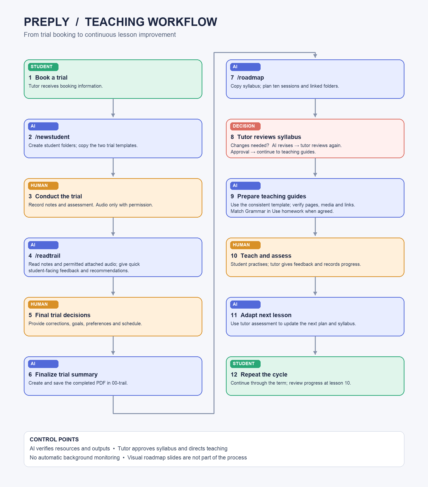

# AI-assisted tutoring workflow

A reusable process for language tutors to move from a trial lesson to a personalized ten-session syllabus and practical teaching guides. The tutor stays responsible for assessment, approval, teaching and progress decisions. It works with book-based or conversation-based lessons.

## What this is

This project contains instructions, copyable prompts and editable text templates. It is **not a standalone app or a fully automatic integration**: a tutor invokes an AI assistant, supplies or connects the relevant materials, reviews its output and performs any steps the assistant cannot access. Nothing runs on a schedule by itself. The example commands in this guide are prompts, not automatically installed slash commands.

## What you need

- An AI assistant that can read the files you choose to provide. For automatic folder or document operations, it also needs an authorized connection to your file storage; otherwise make those changes yourself.
- A place to keep each student's information, trial notes, syllabus and session materials. The examples use Google Drive and Google Sheets, but you can adapt them.
- Your own legally accessible course materials, answer keys and audio/video, if you use them. They are not included here.
- Permission before recording or processing a student's audio. Share only information necessary for the task, using tools appropriate for your privacy obligations.

## Set up in five steps

1. Copy or download this project. Decide where your private student files will live. Keep them outside this repository.
2. Create a **Students** folder and a **Templates** folder in your storage. Make your own copies of the templates in this project's `templates` folder, or adapt existing ones. The syllabus CSV is a starter table, not a prebuilt Google Sheet or progress dashboard.
3. Copy `config.example.md` to `config.private.md` and fill in your own folder links, template locations and materials-library path. This private file is ignored by Git. Do not put passwords, access tokens or student details in it.
4. Connect your assistant to your storage if available, or provide the necessary files manually. Give it `docs/workflow.md`, the relevant prompt and your private configuration. The assistant should read the current instructions each time. These prompts do not install custom skills or authorize access by themselves.
5. Try the process with a **fictional student**. Check the folder structure, sample syllabus and lesson guide. Adapt the templates to your teaching style before using real student information.

## How to use it

1. **Trial booked:** Use [new student](prompts/new-student.md). Create a student folder, a `Road map and progress` folder, and `sessions/00-trial` with the student-info and trial-notes templates.
2. **After the trial:** Complete your notes and use [read trial](prompts/read-trial.md), adding a recording only when permission has been granted. The AI gives you a short script to say to the student, then waits for your final decisions before making a summary.
3. **Plan the term:** Use [term plan](prompts/term-plan.md). The AI drafts at least ten session topics in a syllabus and creates linked session folders. Review and approve the syllabus before lesson guides are produced.
4. **Prepare and teach:** Use [lesson guide](prompts/lesson-guide.md) and the [guide template](templates/teaching-guide.md). Verify actual pages, exercises and media; teach the lesson; record your assessment; adapt the next guide using the student's progress.

The ten-session plan is a working plan. Its dates, actual scores and progress notes should not be invented. A visual Slides roadmap and automatic background monitoring are not part of this process.

## Read next

- [Detailed workflow and human checkpoints](docs/workflow.md)
- [Student information](templates/student-info.md) and [trial notes](templates/trial-notes.md)
- [Trial summary](templates/trial-summary.md) and [syllabus starter](templates/syllabus.csv)
- [Live teaching guide](templates/teaching-guide.md)

## Saving changes with Git

Git keeps a history on your computer; an online service such as GitHub is optional. After editing, check what will be included with `git status`, then use `git add` and `git commit`. Review files before publishing: `.gitignore` is helpful but cannot detect every sensitive document. Never commit student notes, recordings, private links, credentials, or copyrighted books and media. See [the beginner guide](docs/git-for-beginners.md).
