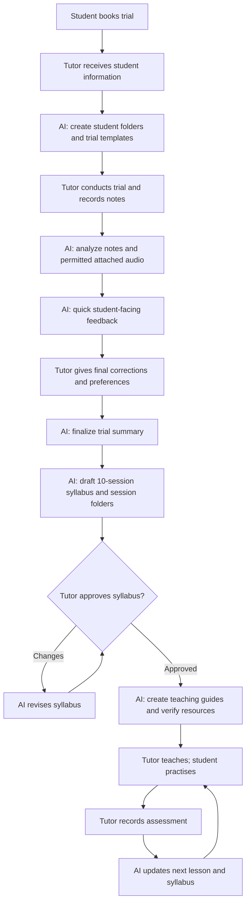

# Workflow and decision points

**Initial setup:** Under the student folder create `Road map and progress` and `sessions/00-trial`. Add copies of student-info and trial-notes templates. Do not create later session folders yet. The tutor fills the information they actually have.

**Trial assessment:** Compare observed performance with the student's stated level. Treat CEFR as provisional; do not infer test scores or abilities not demonstrated. With permission, analyze a supplied recording. If none is supplied, do not seek or assume one. Provide the tutor a short, level-appropriate script covering level, one or two strengths, starting material or topic, a model with a check question, and a concrete lesson-10 goal. Wait for the tutor's final corrections and preferences before making the summary.

**Syllabus:** Copy the user's syllabus template and plan at least one ten-session term. For each session, specify an achievable goal, tasks, useful materials and agreed homework. Do not fill dates, times, lesson-plan links or scores prematurely. Create corresponding folders under `sessions`, link each folder to its syllabus row, and preserve progress formulas/charts if the user's template has them. The tutor reviews and may request revisions. Explicit approval comes before creating lesson guides.

**Lesson guides:** Use the same teaching-guide template for a consistent appearance. Plan a clear 50-minute sequence unless a different length is agreed: what to say and do, questions, answers where applicable, feedback, checks and alternatives. Inspect actual book pages, exercises and relevant teacher keys before identifying exact references. Check audio/video directly; give its verified location and pre/during/after instructions, answer check and fallback. Put necessary materials in the session folder when authorized and permitted. A grammar lesson should include a verified, level-appropriate Grammar in Use reference as homework if homework is agreed; otherwise flag missing material rather than inventing it. Conversation lessons need concrete prompts and a learning goal; do not force a book or grammar homework.

**Loop:** The tutor teaches and records what happened. The assistant uses that assessment to revise the next plan and, when appropriate, the syllabus. Do not invent progress, grades or commitments. Tutors may plan guides ahead, but should revise them in light of actual learning.

**Efficiency:** Reuse the same templates and existing indexes. Read only the records and resources needed for the task, batch independent checks when possible, and verify outcomes without redundant work. Never skip material verification or the tutor's approval to save time.
